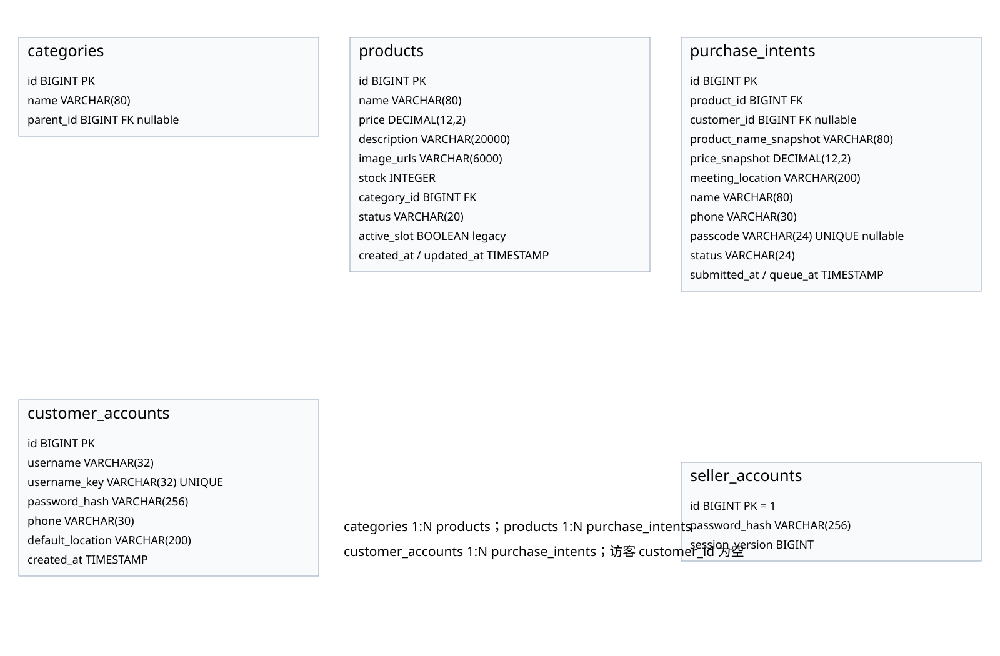
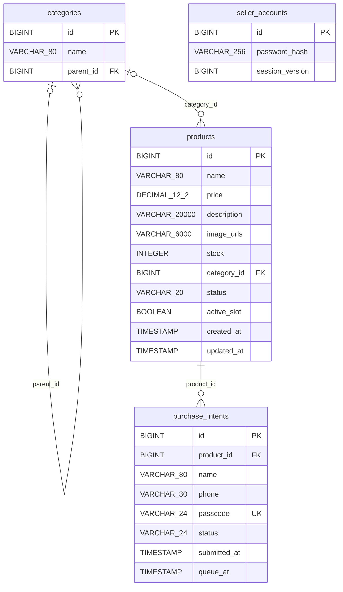

# 后端数据模型图

版本 V2.1，2026-10-21。记录当前源码的 JPA 实体结构；本轮成果展示范围见第二轮功能说明。

## 可编辑的 ER 图

## 字段与关联

| 表 | 字段或约束 | 说明 |
| --- | --- | --- |
| categories | parent_id | 空为一级，非空指向一级分类；服务层拒绝三级与循环。 |
| products | stock | 非负整数，既有商品升级默认 1；成功交易减 1，零库存下架。 |
| products | category_id | 可空；关联一级或二级分类；筛选一级时包含子类商品。 |
| products | description / image_urls | 清理后的富文本最多 20000 字符；相册 URL 以竖线拼接，最多 9 张。 |
| products | active_slot | 废弃的兼容字段，新商品写空，不再以该字段限制唯一有效商品。旧数据库原约束可保留，因为多个空值不互斥。 |
| purchase_intents | product_id | 必填外键；每件商品有独立 FIFO 队列。 |
| purchase_intents | passcode | 可空且唯一，结束后置空；历史行继续保留。 |
| purchase_intents | queue_at / submitted_at | 前者可因重排改变；后者保留原提交时间。 |
| seller_accounts | password_hash | 带随机盐的 PBKDF2-HMAC-SHA256 编码。 |
| seller_accounts | id / session_version | 固定卖家 id=1；修改密码递增版本，撤销旧登录。 |

商品状态：`ON_SALE`、`MANUALLY_FROZEN`、`IN_TRADE`、`DELISTED`。
意向状态：`WAITING`、`IN_TRADE`、`TRADE_SUCCESS`、`TRADE_FAILED`、`VOIDED`、`CANCELLED`、`PRODUCT_DELISTED`。

A.2 客户账号及购买历史已回退，当前不包含客户实体或客户查询接口。
