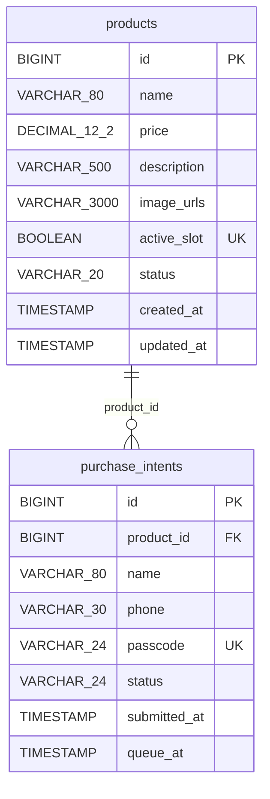

# 后端数据模型图

本图依据当前 `src/main/java/cn/codelyy/store/domain` 下的 JPA 实体绘制，反映 MVP v1.0 后端实际使用的数据结构。

## 可编辑的 ER 图

## 字段和业务说明

| 数据表 | 字段 | 约束与用途 |
| --- | --- | --- |
| `products` | `id` | 主键，自增。 |
| `products` | `name`、`price`、`status`、`created_at`、`updated_at` | 必填；`price` 精度为 12 位、小数 2 位。 |
| `products` | `description`、`image_urls` | 可为空；图片地址列表保存在 `image_urls` 字符串中。 |
| `products` | `active_slot` | 可为空且唯一；当前上架商品占用 `true`，下架后置空。 |
| `purchase_intents` | `id` | 主键，自增。 |
| `purchase_intents` | `product_id` | 必填外键，指向 `products.id`；一件商品可对应多条购买意向。 |
| `purchase_intents` | `name`、`phone`、`status`、`submitted_at`、`queue_at` | 必填；排队先按 `queue_at`、再按 `id` 升序。 |
| `purchase_intents` | `passcode` | 可为空且唯一；意向失效时置空。 |

商品状态：`ON_SALE`、`IN_TRADE`、`DELISTED`。

购买意向状态：`WAITING`、`IN_TRADE`、`TRADE_SUCCESS`、`TRADE_FAILED`、`VOIDED`、`CANCELLED`、`PRODUCT_DELISTED`。

索引：`idx_product_status_created(status, created_at)`、`idx_intent_product_queue(product_id, status, queue_at)`、`idx_intent_passcode(passcode)`。当前代码没有独立的卖家、图片、交易或历史记录数据表；此图只表示已实现结构。
