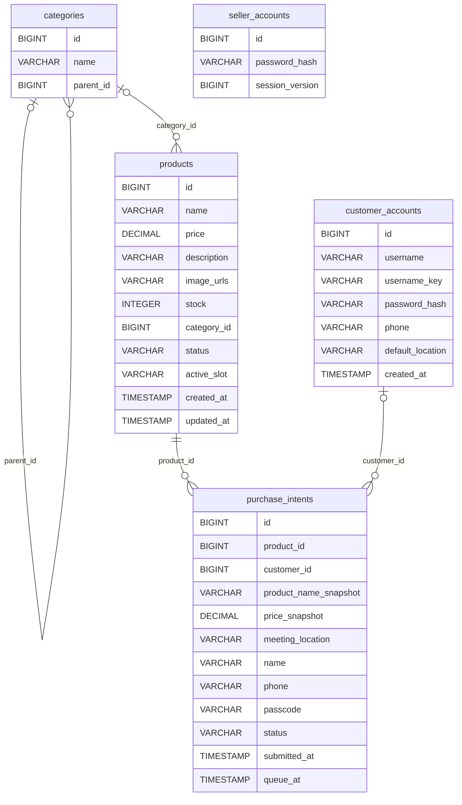

# 后端数据模型图

版本V3.0；日期2026-10-24。第三轮新增客户账号及客户意向归属、地点和商品快照字段。

## 实体关系

## 第三轮新增结构

| 表或字段 | 含义 |
| --- | --- |
| customer_accounts | 新增客户账号表，大小写归一用户名唯一，密码只存PBKDF2哈希。 |
| purchase_intents.customer_id | 可空客户外键；既有访客意向保持空，不凭姓名电话回填。 |
| product_name_snapshot / price_snapshot | 下单时商品名称与价格快照，后续商品编辑不修改。 |
| meeting_location | 本次交易地点，注册客户提交必填；默认来自客户账号。 |
| idx_intent_customer_submitted | customer_id、submitted_at、id索引，支持客户历史分页。 |

卖家账号为固定系统身份，与客户账号分表；密码哈希不放入任何接口DTO。
