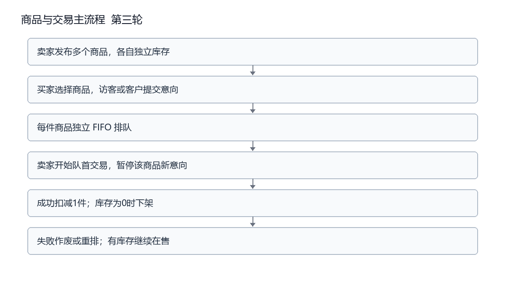
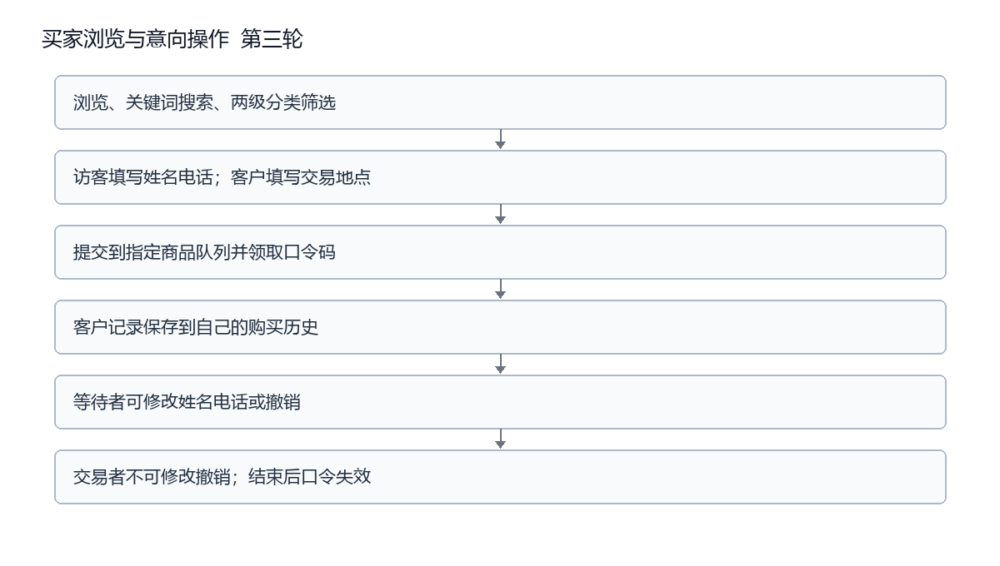
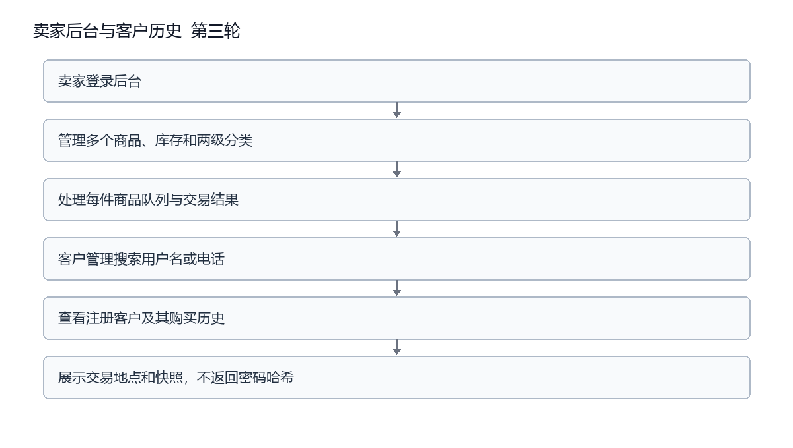
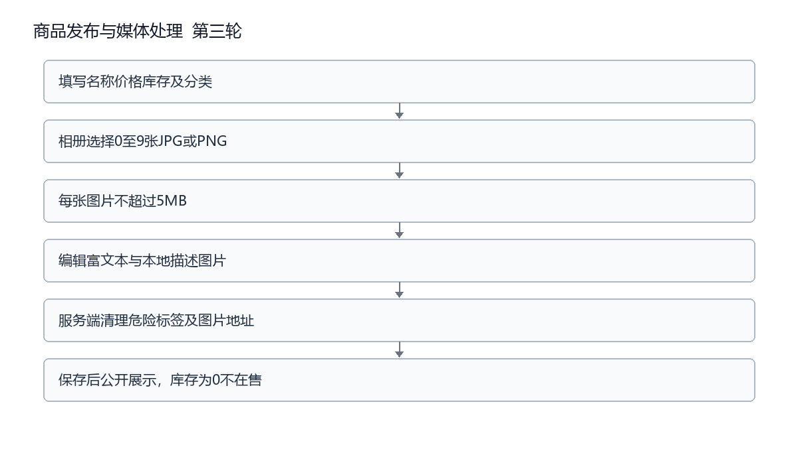
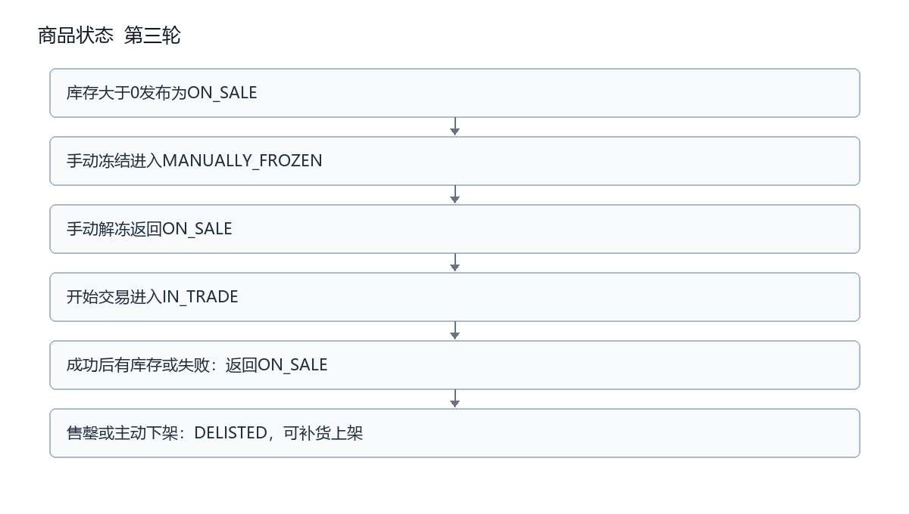
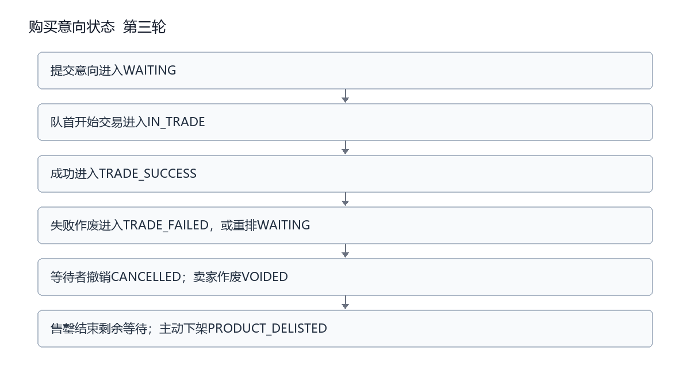
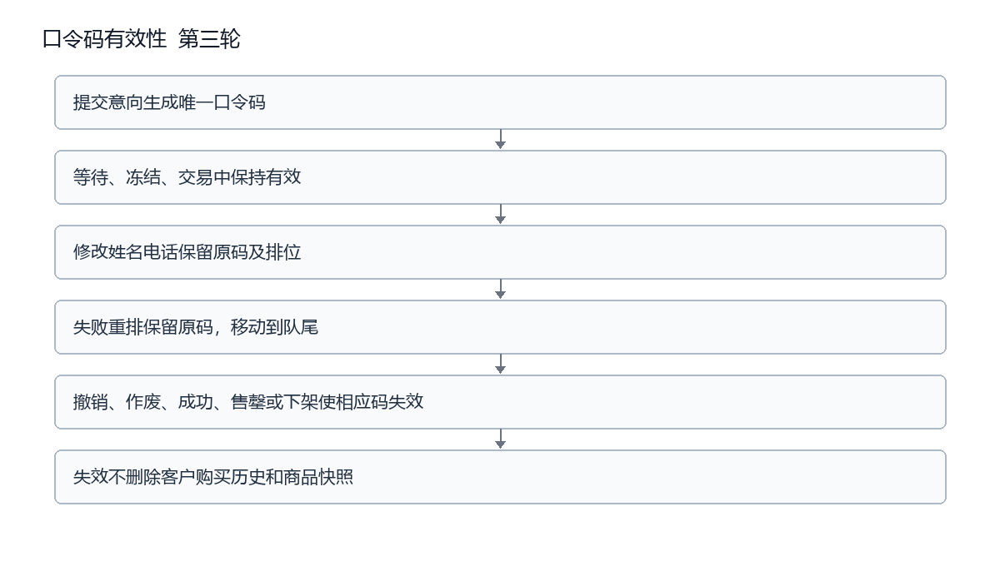

# 在线购物系统需求规格说明书

版本 V3.1；修订日期 2026-11-03。本说明整合三轮功能，第三轮验收挑战需求 A.1 与 A.2，已实现规则沿用 V3.0；第11章新增后续拓展需求规划，全部待评审、待实现，不计入前三轮已完成内容。

## 术语表

| 术语 | 定义 |
| --- | --- |
| 访客 | 不注册也可浏览商品、按姓名电话提交意向，通过口令码管理。 |
| 注册客户 | 填写用户名、密码、电话及默认交易地点注册，登录后可保存和查看自己的购买记录。 |
| 卖家 | 唯一后台账号，管理商品、分类、库存、交易和注册客户。 |
| 选中商品 | 列表中正在查看或操作的商品，可同时存在多个有效商品。 |
| 购买意向 | 针对一个指定商品的一件购买申请；每件商品独立FIFO队列。 |
| FIFO | 按服务端queue_at升序，相同时间按意向编号升序。 |
| 手动冻结 | 只暂停该商品接收新意向，保留队列，可由卖家解除。 |
| 交易冻结 | 该商品已有队首交易，必须先登记结果，不能手动解除。 |
| 库存 | 0～1000000整数；成功减1，失败不减，归零自动下架。 |
| 口令码 | 单条意向的持有者凭据；意向结束后置空，历史不删除。 |
| 商品快照 | 客户下单时保存的商品名称和价格，后续改商品不回写快照。 |
| 两级分类 | 一级与二级父子分类，禁止三级、循环、同级重名。 |
| 富媒体描述 | 允许的格式化文字及本地描述图片；危险标签及图片地址清理或拒绝。 |

## 1 迭代范围

| 轮次 | 验收内容 |
| --- | --- |
| 第一次 | 访客浏览、单件商品基本发布、姓名电话与口令码、FIFO、交易成功失败、主动下架、图片基础上传。 |
| 第二次 | 等待买家修改姓名电话；手动冻结和解冻；卖家修改密码及旧会话撤销。 |
| 第三次 | A.1 多商品、两级分类、库存、搜索、多图富媒体；A.2 客户注册登录、客户历史、卖家客户查询。 |

## 2 角色与权限

访客可免登录浏览、搜索、筛选商品并提交意向；注册客户保留访客能力，登录后可查看自己账号提交的购买记录。卖家必须登录才能管理商品、队列、分类、客户和客户历史。

客户历史的归属只使用服务端会话中的客户编号，不接受客户端指定其他客户编号；同名或同电话访客意向不能自动认领。卖家客户查询不返回密码、密码哈希或客户口令码。

## 3 商品和分类需求

| 字段或能力 | 规则 |
| --- | --- |
| 同时发布 | 允许多个商品同时在售；冻结、交易、库存与等待队列按商品隔离。 |
| 名称 | 必填，最多80字符。 |
| 价格 | 大于0，最多2位小数，整数部分最多10位。 |
| 库存 | 0～1000000整数；0库存商品发布即下架；交易中禁止编辑。 |
| 分类 | 商品可关联一个一级或二级分类，也可未分类；一级筛选包含子类。 |
| 分类维护 | 新增、编辑、删除；禁止三级、循环与同级重名，已被商品或子类引用时拒绝删除。 |
| 图片 | 0～9张JPG/PNG，每张不超过5MB；保持相册顺序，前端可切换缩略图。 |
| 描述 | 最多20000字符，清理后仍检查长度；支持标题、段落、加粗、斜体、列表及本地图片。 |
| 浏览和搜索 | 按名称或描述可见文字搜索，支持分类筛选、分页；每页1～100条，页码从0开始。 |

第三轮替代首轮的“同一时间唯一商品”“最多一张图片”和“每次成功必然下架”规则。多标签、商品视频和视频自动删除仍属于后续需求，不计入三轮已实现功能。

## 4 购买意向与队列

每条意向对应1件指定商品，姓名必填且最多80字符；电话须含数字，允许数字、加号、括号、空格、短横线，总长度6～30字符。仅在售且有库存的商品接受新意向。

访客提交成功领取唯一口令码，注册客户提交还必须确认交易地点，长度1～200字符，默认填入注册地点；本次地点修改不修改账号默认地点。服务端保存customer_id、product_name_snapshot、price_snapshot和meeting_location。

队列按每个商品的queue_at和id排序，卖家只能开始队首交易。等待中凭码可修改姓名电话或撤销；修改保留编号、提交时间、原码及排位。交易中的买家不能修改或撤销；同一商品其他等待者仍可修改或撤销。

## 5 交易和状态

| 操作 | 结果 |
| --- | --- |
| 开始交易 | 商品ON_SALE转IN_TRADE；队首WAITING转IN_TRADE，拒绝该商品新意向。 |
| 成功且剩余库存大于0 | 当前意向TRADE_SUCCESS并清空口令码，库存减1，商品恢复ON_SALE；其他等待者继续排队。 |
| 成功后库存为0 | 商品DELISTED，当前意向成功；其他等待意向结束为TRADE_FAILED并清空口令码。 |
| 失败并作废 | 当前意向TRADE_FAILED，口令码失效，库存不变，商品恢复ON_SALE。 |
| 失败并重排 | 当前意向回WAITING，保留原码并更新queue_at到队尾；库存不变。 |
| 手动冻结与解冻 | ON_SALE与MANUALLY_FROZEN之间转换；原等待队列和口令码保留。 |
| 主动下架 | 只允许ON_SALE；等待者转PRODUCT_DELISTED，口令码失效。 |
| 补货上架 | DELISTED且库存大于0允许重新上架；历史意向不自动恢复。 |

卖家作废等待者使用VOIDED状态；买家撤销使用CANCELLED状态。没有超时自动成交或自动处理下一位买家。已结束意向和客户历史持久保留。

## 6 客户升级 A.2

| 编号 | 验收要求 |
| --- | --- |
| A.2-1 | 客户可自由注册；用户名3～32位Unicode文字、数字、下划线或短横线，大小写不区分重复；密码8～128位，电话符合规则，默认交易地点必填且最多200字符。注册成功自动登录。 |
| A.2-2 | 客户登录后查看本人购买历史，包含等待、交易、成功、失败、撤销、作废和下架结束记录；按提交时间和编号倒序分页。显示商品快照、联系人、交易地点、状态、时间及有效排位。 |
| A.2-3 | 卖家查看所有注册客户的用户名、电话、默认地点、注册时间；可按用户名或电话搜索，并分页查看指定客户购买历史。 |

## 7 登录和密码

卖家初始账号admin/123456仅用于首次建库。卖家改密验证原密码，新密码8～128位，增加会话版本使所有旧卖家会话失效。

卖家和客户密码均使用PBKDF2-HMAC-SHA256、600000次迭代、16字节独立随机盐、32字节派生结果存储。HTTP Session保存角色身份；登录更换会话编号；客户与卖家身份分开管理，客户退出只清除客户身份，卖家退出或改密只清除卖家身份。

## 8 数据与实现边界

数据库为H2文件库，日常运行保留data目录。JPA根据实体更新结构，新字段可空以兼容旧访客意向。产品、分类、卖家账号、客户账号、购买意向共五类实体。

客户购买历史使用当前意向记录及下单快照，不代表每次重排和每次交易尝试均有独立事件表。完整操作审计、商品视频、多标签、客户自助修改默认地点等未实现部分不列为第三轮通过项。

## 9 业务流程与状态图

下列七张图按第三轮业务规则更新，为各流程和状态规则示意。

### 商品与交易主流程

### 买家浏览与意向操作

### 卖家后台与客户历史

### 商品发布与媒体处理

### 商品状态

### 购买意向状态

### 口令码有效性

## 10 验收与测试

三轮测试均包含总方案、总用例、每总用例至少8个详细实例。功能测试和接口测试分目录，接口使用JUnit、MockMvc及独立内存H2读取实例文件；页面功能测试另记人工结果。边界值、等价类、状态转换和权限隔离等方法见各轮测试文档及Excel末行。

## 11 后续拓展需求规划

### 11.1 规划目标与适用范围

在现有三轮商品和客户功能基础上，增加商品表达与查找方式的多样性，并允许客户自主选择收藏、偏好、通知和页面展示方式。本章为新增规划，不是已实现功能或课程新增强制验收项。所有条目状态均为待评审、待实现；本次仅修改需求规格说明书，不安排开发、不修改接口、数据库、代码、测试或现有交付结论。

规划优先级P1表示建议优先讨论的基础拓展，P2表示依赖较多的后续拓展；它们不是已承诺排期，也不对应禅道默认优先级。是否进入第四次及后续迭代，由需求评审后确定。以下数量、格式和长度为拟定验收约束，评审可调整，确定后应同步需求版本。

### 11.2 拓展需求清单

| 编号 | 需求名称 | 方向 | 建议优先级 | 状态 |
| --- | --- | --- | --- | --- |
| EXT-01 | 商品多标签与多维筛选 | 多样化 | P1 | 待评审、待实现 |
| EXT-02 | 商品规格与独立规格库存 | 多样化 | P2 | 待评审、待实现 |
| EXT-03 | 商品短视频与图文组合介绍 | 多样化 | P2 | 待评审、待实现 |
| EXT-04 | 商品收藏与个人收藏清单 | 个性化 | P1 | 待评审、待实现 |
| EXT-05 | 个人浏览记录与清除管理 | 个性化 | P1 | 待评审、待实现 |
| EXT-06 | 偏好设置与可解释商品推荐 | 个性化 | P2 | 待评审、待实现 |
| EXT-07 | 常用交易地点与联系资料管理 | 个性化 | P1 | 待评审、待实现 |
| EXT-08 | 收藏商品补货与价格提醒 | 个性化 | P2 | 待评审、待实现 |
| EXT-09 | 交易进展站内消息 | 个性化 | P1 | 待评审、待实现 |
| EXT-10 | 页面主题与展示偏好 | 个性化 | P1 | 待评审、待实现 |
| EXT-11 | 商品对比清单 | 多样化 | P2 | 待评审、待实现 |
| EXT-12 | 成交评价与个人展示控制 | 多样化及个性化 | P2 | 待评审、待实现 |

### 11.3 详细需求与拟定验收标准

#### EXT-01 商品多标签与多维筛选

涉及页面：卖家商品编辑区、买家商品列表筛选区。

需求内容：卖家为商品维护不超过5个标签，每个标签1～20字符，去除首尾空格后不得重复；买家按标签、价格区间和在售状态组合筛选，保留现有关键词、两级分类与分页能力。标签是分类的补充，不新增第三层分类。

拟定验收标准：筛选条件同时生效，价格下限不得大于上限；更改条件回到第一页；清空条件恢复默认列表；无匹配商品展示空结果；非法标签和价格范围被拒绝。

依赖与边界：依赖现有分类、商品查询及分页；先明确同一维度的多选逻辑。

#### EXT-02 商品规格与独立规格库存

涉及页面：卖家规格编辑区、买家商品详情及意向弹窗。

需求内容：商品可选择启用颜色、尺寸或版本等规格，最多2个规格维度，每维最多10个选项；每个有效规格组合维护独立价格、库存及可选图片。买家提交意向前选择具体规格，历史保存规格快照；未启用规格的商品沿用当前流程。

拟定验收标准：售罄规格不可提交意向；成交只扣减所选规格库存；所有规格售罄才自动下架商品；队列、冻结和交易按规格组合隔离；不同规格间库存不互相扣减。

依赖与边界：实施前单独评审商品总库存汇总、规格队列和旧意向迁移方案，不能直接套用当前单库存规则。

#### EXT-03 商品短视频与图文组合介绍

涉及页面：卖家媒体管理区、买家商品详情。

需求内容：每个商品可增加1段MP4视频，建议时长不超过60秒、文件不超过50MB，并可设置封面；保留原有图片相册和富文本描述。视频由买家主动播放，不默认有声自动播放。

拟定验收标准：超出格式、大小或时长限制时拒绝上传；无视频商品正常展示；替换视频后解除旧引用；商品下架不立即删除历史资料，仅清理确认无任何引用的媒体文件。

依赖与边界：需要媒体格式校验、存储配额和无引用文件清理方案；视频转码和外部视频链接不包含在本项首期范围。

#### EXT-04 商品收藏与个人收藏清单

涉及页面：商品卡片、商品详情、个人中心收藏页。

需求内容：注册客户可以收藏或取消收藏商品，个人清单按收藏时间倒序分页；重复收藏不重复新增。清单展示商品名称、图片、当前价格、库存及在售状态，下架商品保留状态提示。

拟定验收标准：未登录操作提示登录；仅能查看和修改本人收藏；取消后清单更新；下架商品不能从收藏入口绕过限制提交意向；收藏不占库存或队列位置。

依赖与边界：依赖客户身份及商品查询；收藏记录与购买历史分开管理。

#### EXT-05 个人浏览记录与清除管理

涉及页面：商品详情、个人中心最近浏览页。

需求内容：注册客户可选择开启浏览记录，默认关闭；开启后记录本人最近浏览的商品，重复浏览更新最近时间，最多保留100项。客户可以删除单项、清空全部或关闭记录，关闭时停止新增。

拟定验收标准：未开启时不新增记录；重复商品不产生重复条目；超出100项移除最早记录；仅本人可查询和清除；已清除记录不继续用于个性化推荐。

依赖与边界：实施前确认保留期限；访客不跨设备关联或建立个人浏览档案。

#### EXT-06 偏好设置与可解释商品推荐

涉及页面：个人中心偏好设置、买家首页推荐区。

需求内容：客户可主动设置感兴趣的分类、标签和预算区间，并单独开启个性化推荐，默认关闭。推荐优先依据主动偏好，可在客户开启浏览记录后使用其记录，展示“符合关注分类”等推荐原因；支持不感兴趣和重置偏好。

拟定验收标准：关闭后恢复统一的默认商品列表；无偏好或无匹配时展示可浏览的在售商品；推荐不能包含下架商品或改变FIFO排位、成交价格和权限；历史记录清除或偏好重置后不继续使用旧信号。

依赖与边界：首期使用可解释的规则推荐，不承诺机器学习模型或推荐准确率；依赖标签及偏好数据。

#### EXT-07 常用交易地点与联系资料管理

涉及页面：个人中心资料页、购买意向弹窗。

需求内容：客户可维护显示昵称、联系电话及最多5个常用交易地点，设置其中一个为默认地点；已有注册地点自动作为初始默认项。用户名作为登录标识暂不允许修改。意向提交时选择常用地点，仍允许填写本次临时地点。

拟定验收标准：地点必填且不超过200字符；最多一个默认项；仅本人能编辑；修改默认资料不回写已提交意向和商品快照；删除默认地点时要求重新选择或明确取消默认。

依赖与边界：依赖客户身份；涉及历史隐私资料和默认项迁移，需单独评审。

#### EXT-08 收藏商品补货与价格提醒

涉及页面：商品详情关注设置、个人中心消息中心。

需求内容：客户可对收藏商品分别订阅补货或降价提醒，随时取消。已下架商品补货并重新上架后产生补货消息；当前价格低于订阅时参考价格时产生降价消息。首期只使用站内通知。

拟定验收标准：未订阅或已取消不发送新提醒；同一事件同一客户只产生一条消息；消息展示事件时间、商品和当时价格；点击后按当前状态查询；提醒不预留库存和购买排位。

依赖与边界：依赖收藏、价格变更和重新上架事件；短信、邮件、推送及促销承诺不在首期范围。

#### EXT-09 交易进展站内消息

涉及页面：个人中心消息中心、卖家交易操作结果。

需求内容：为注册客户生成本人意向进入交易、成功、失败和因商品下架结束的站内消息，提供未读数、分页、单条已读和全部已读。消息引用意向编号，不在列表正文展示口令码和完整电话。

拟定验收标准：业务处理成功后才产生消息；重复请求不重复通知；只能读取和标记本人消息；消息链接重新校验当前权限与状态；消息失败不得造成重复扣库存或状态回滚混乱。

依赖与边界：需明确消息生成可靠性及失败重试方案；访客继续使用口令码查询。

#### EXT-10 页面主题与展示偏好

涉及页面：公共导航设置入口、商品列表。

需求内容：提供浅色、深色和跟随系统主题，商品列表可选择网格或列表视图，提供标准及大字号显示。访客偏好仅保存本设备，注册客户可选择保存到账号，退出后不向下一账号继承私有设置。

拟定验收标准：切换不改变筛选结果及业务数据；刷新后按选定保存范围恢复；文字、按钮和状态可辨认；键盘可操作主要控件；移动端不出现遮挡或无法操作。

依赖与边界：默认延续当前界面；不将视觉偏好作为推荐、价格或权限依据。

#### EXT-11 商品对比清单

涉及页面：商品列表对比入口、商品对比页。

需求内容：买家可将2～4个不同商品加入对比，按名称、价格、分类、规格、库存和描述摘要并列查看；可以移除单项或清空清单。未配置规格的商品显示未提供，不能据此推断性能。

拟定验收标准：重复加入不新增条目；第5个商品提示先移除；不足2个时提示继续选择；价格和状态以最新查询为准；下架商品可显示状态但不可提交意向。

依赖与边界：依赖统一展示字段；对比不自动代替买家选择，也不改变排队或库存。

#### EXT-12 成交评价与个人展示控制

涉及页面：本人购买历史评价入口、商品详情评价区、卖家评价管理。

需求内容：客户仅能对本人TRADE_SUCCESS意向提交一次1～5星评价及不超过500字符的文字；可选择公开昵称或匿名显示，默认匿名，不公开电话和地点。卖家可以回复一次，举报内容交由人工审核，不得直接改写客户评价。

拟定验收标准：未成交、他人意向和重复评价被拒绝；公开内容不包含客户敏感字段；危险内容清理；审核隐藏保留原因及记录；评价不影响库存、交易状态和队列优先级。

依赖与边界：实施前评审评价撤回、审核角色与纠纷规则；首期不开放评价图片和自动审核。

### 11.4 共性约束

隐私与选择：收藏、偏好、浏览记录和消息均按客户身份隔离，不通过客户端指定他人客户编号操作。浏览记录与个性化推荐分别开关，不以接受个性化为浏览或购买前提；客户可清除记录、取消订阅和重置偏好。

业务公平：个性化仅改变发现、展示和通知方式，不能插队、占库存、调整实际成交价格或绕过商品状态与权限。当前按商品FIFO规则继续适用；只有EXT-02另行评审通过后，才对启用规格的商品采用规格级队列。

历史兼容：没有标签、视频、规格或个性化设置的现有商品和客户仍可正常使用。新增资料和偏好不回写已保存的商品及交易快照；不得在需求评审前调整现有七张业务流程和状态图。

数据与安全：新增内容统一进行服务端校验与安全渲染；价格比较按现有金额精度处理；收藏、订阅、评价、已读及事件通知应防止重复处理。个人数据保留期限、清除范围和审核权限在开发前确认。

### 11.5 后续评审与验收安排

建议先评审标签筛选、收藏、资料与地点、展示偏好等P1需求，再评审规格库存、推荐、媒体、提醒、对比与评价等依赖较多的需求。此顺序仅供规划，不代表本次新增任务分工或工期承诺。

每项需求通过评审后再拆分页面、接口、数据变更和测试任务，并明确负责人。测试延续功能测试与接口测试分目录、总方案与详细实例分层的方式；依据边界值、等价类、状态转换、权限隔离和场景法验证新规则。尚未实现的条目不得记录为测试通过或已完成成果。

### 11.6 本次修订记录

2026-11-03，V3.0升级为V3.1：保留前三轮已实现需求和七张业务流程及状态图，新增EXT-01至EXT-12共12项拓展规划及其拟定验收条件。仅更新需求规格说明书Markdown和Word，未修改程序、接口说明、测试、表格或阶段性报告。
